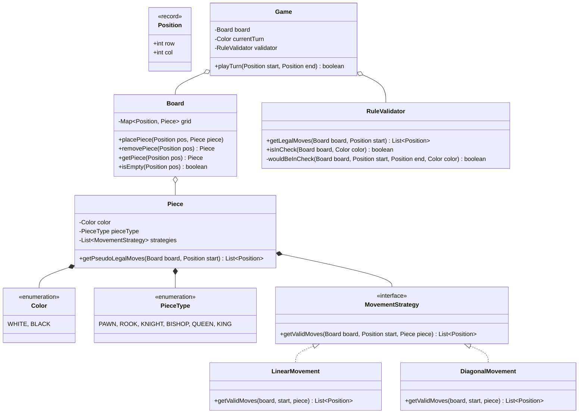

# Implementación de Ajedrez - MVP (Java + Spring Boot)

Este documento detalla el diseño arquitectónico y plan de implementación para el motor de Ajedrez, respetando los requerimientos de la cátedra de la TPO: separación entre núcleo y adaptadores, SOLID y composición sobre herencia.

## 1. Arquitectura General (Hexagonal / Puertos y Adaptadores)

Usaremos **Java 21**, **Maven** y **Spring Boot**. Para cumplir estrictamente con la consigna de que *"el núcleo no debe depender de ningún framework"*, aplicaremos Arquitectura Hexagonal real:

1. **Capa de Dominio (Núcleo Puro):** Clases 100% Java (`java.lang.*`, `java.util.*`). **Cero anotaciones de Spring** (`@Service`, `@Component`, etc. están prohibidas aquí). Las reglas de negocio, validaciones y modelos viven aquí. Todo se testea con `JUnit 5` puro.
2. **Capa de Aplicación y Adaptadores (Spring Boot):** Aquí usaremos Spring Boot para exponer el juego, por ejemplo a través de una API REST simple (`@RestController`) y una pequeña página web o consola interactiva. Spring instanciará las clases del núcleo y las inyectará donde haga falta mediante `@Configuration`.

### Estructura de paquetes (Maven Standard):
```text
src/main/java/com/tpo/chess/
├── core/                       # Núcleo del juego (DOMINIO PURO JAVA)
│   ├── models/                 # Records y Enums (Position, Piece, Color, PieceType)
│   ├── board/                  # Gestión del tablero
│   ├── movement/               # Patrón Strategy para movimientos (composición)
│   ├── rules/                  # Validadores (jaque, legalidad)
│   └── Game.java               # Fachada y orquestador principal
├── adapter/                    # Capa de Adaptadores (SPRING BOOT)
│   ├── controller/             # Controladores REST o CLI
│   └── dto/                    # Objetos de transferencia de datos
├── config/                     # Configuración de Spring
│   └── ChessAppConfig.java     # Fabrica los beans del 'core'
└── ChessApplication.java       # Main de Spring Boot

src/test/java/com/tpo/chess/
└── core/                       # Tests unitarios JUnit 5 del núcleo
```

## 2. Decisiones de Diseño (Composición sobre Herencia)

**El problema clásico:** Hacer `class Peon extends Piece`, `class Torre extends Piece`. Esto crea acoplamiento fuerte y dificulta escalar.
**La solución:** Usar el **Patrón Strategy (Composición)**. Tendremos una sola clase concreta `Piece` que implementa su comportamiento de movimiento teniendo una `List<MovementStrategy>`.

### Justificaciones de Diseño para la TPO (Qué / Por qué / Cuándo se rompería):

1. **Uso de Strategy para los movimientos (Composición en lugar de Herencia):**
   - **Qué:** En lugar de heredar de `Piece`, se compone inyectando implementaciones de la interfaz `MovementStrategy`.
   - **Por qué:** Cumple el Principio Open/Closed. Si mañana piden una pieza nueva que combina saltos de caballo con avances de torre, simplemente instanciamos un `Piece` pasándole ambas estrategias, sin crear jerarquías de clases nuevas.
   - **Cuándo se rompería:** Si el movimiento de una pieza requiriese conocimiento directo sobre el input del usuario o de un motor gráfico externo (violando la capa de dominio), haciendo que la estrategia pura falle.

2. **Aislamiento de Spring Boot mediante @Configuration:**
   - **Qué:** El `Game` no tiene la anotación `@Service`. En su lugar, usamos una clase `ChessAppConfig` anotada con `@Configuration` que instancia `new Game()` y lo devuelve anotado con `@Bean`.
   - **Por qué:** Permite separar completamente el framework del núcleo de negocio. El `core` puede compilarse y testearse de forma aislada sin levantar el contexto de Spring.
   - **Cuándo se rompería:** Si en el futuro necesitáramos que una regla de negocio consuma un servicio web externo (ej. una IA en la nube), obligando al núcleo a conocer sobre clientes HTTP, rompiendo la dependencia invertida si no se usan Puertos (Interfaces).

3. **Uso de Java Records para Entidades Inmutables:**
   - **Qué:** `Position` será un `record Position(int row, int col) {}`.
   - **Por qué:** Nos da inmutabilidad, `equals()`, `hashCode()` y `toString()` automáticos por el lenguaje, evitando errores sutiles de comparación en colecciones como diccionarios o listas.

## 3. Diagrama de Clases (UML - Mermaid)



## 4. Alcance del MVP
1. **Configuración de Spring Boot y Maven:** Proyecto base inicializado.
2. **Dominio 100% Core Java:** `Piece`, `Board`, strategies de movimiento puras, y reglas de la partida.
3. **Adaptador Spring Boot (Controlador REST o Shell):** Para poder jugar la partida desde afuera.
4. **Tests Unitarios:** Verificación directa de las reglas del núcleo (jaque, bloqueos, movimientos ilegales) usando JUnit 5 sin levantar el servidor de Spring.

## Siguientes Pasos
Si estás de acuerdo con esta aproximación para Java + Spring, el próximo paso es:
1. Crear el proyecto base Maven (`pom.xml`).
2. Codificar las interfaces y records del núcleo de dominio.
3. Continuar iterativamente capa por capa hasta llegar al adaptador web de Spring.
